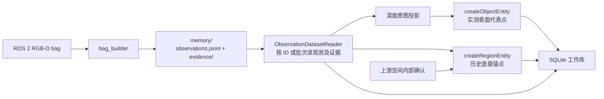

# vln_memory 当前架构

当前交付范围为原设计第 1、2 部分，项目推进到 **S3 几何与工作库**。已实现录包准备、正式观测发布、地图几何投影以及物品与空间创建。已定位和待定位实体可写入 SQLite 工作库并按原 ID 回读。当前进度和验收条件见 [范围对照](sections_1_2_scope.md) 与 [系统规划](system_plan.md#102-后续任务与依赖)。

## 数据流与边界



BagBuilder 是离线程序，负责配对、标定、历史位姿、选帧和正式观测发布。MemoryEngine 的语义构建从已发布观测开始。现有 `memory_semantic_build` 接收调用方提供的结构化操作，模型循环与工具调度仍在规划中。

| 层 | 职责与依赖 |
| --- | --- |
| `bag/common`、`bag/rgb`、`bag/depth`、`bag/camera_info`、`bag/tf` | 定义传感器基础类型，完成图像解码、标定匹配、历史 TF 查询和数值投影。核心库使用 C++17，ROS 适配映射消息字段。 |
| `bag/builder` | `BagBuilder` 读取录包、配对和导出，`PreparationReader` 建立配对索引并核对来源，`preparation_compact` 生成可回读的精简副本。 |
| `memory` | `Observation` 保存正式观测、证据与版本并提供校验和 JSON 编解码。`Entity` 保存永久 ID、修订、状态及物品或空间证据。两者可作为独立的 C++ 记录使用。 |
| `engine` | 保存供 BagBuilder 复用的确定性选帧和观测组装函数，以及供语义构建使用的观测读取、投影与实体业务接口。 |
| `apps` | 命令行解析及结果报告。当前入口为 `bag_builder`、`preparation_compact`、`memory_build_input` 和 `memory_observation_dataset`。 |

## 三类产物

| 产物 | 入口与作用 |
| --- | --- |
| preparation | `bag_preparation/1`。保存媒体、源消息摘要、配对、相机模型、历史 TF 和待处理报告。新导出的 v7 manifest 绑定媒体 SHA-256 索引。 |
| 正式观测与证据 | 直出使用 `observation_dataset/3`，根包含 `observations.jsonl` 和 `evidence/`，后者含媒体、来源清单和摘要索引。旧 v1/v2 目录沿用各自的 preparation 绑定。 |
| 实体记录 | 拥有型 C++ `Entity`，状态为 `located` 或 `pending_location`。物品保存深度选区和表面代表点，空间保存内部确认与底盘锚点。SQLite 工作库绑定正式观测集，支持按实体修订追加观测，并按 ID 回读所有证据。完整记忆版本待实现。 |

## 时间、几何与证据

- 正式观测以 RGB 原始采样时间为参考，保留两路原始时间、实际时差、时钟与数据段。RGB 相机及底盘位姿查询用 RGB 参考时刻，深度相机位姿使用 Depth 时刻。详见 [时间契约](observation_time_contract.md)。
- 深度到地图使用米制 optical-z、该图的有效模型和历史深度位姿。物品代表点来自深度选区中可信簇的实测像素。深度到 RGB 候选像素仍依赖设备标定、外参和实际时间关系。
- 空间代表点取自经上游确认在区域内的 `body_pose_map` 平移。确认绑定观测修订、来源指纹及地图几何版本，直出格式的创建器使用从发布目录回读并校验的正式观测。底盘朝向仍属观测。详见 [实体创建](../modules/engine/entity_builder.md)。
- 直出 Reader 按观测引用读取媒体并核对摘要，旧格式通过 [PreparationReader](../modules/bag/preparation_reader.md) 回查。结构合法但缺几何的记录保留待定位原因。

## 源码、构建和验证

```text
include/vln_memory/
├── bag/                 # common、rgb、depth、camera_info、tf、builder
├── memory/              # observation、entity
└── engine/              # 选帧、观测组装/发布、回读投影、实体创建
src/
├── bag/                 # 传感器、几何和 preparation 实现
├── memory/              # 业务记录的实现
├── engine/              # 离线构建流程
└── apps/                # 命令行入口
test/
├── bag/                 # 核心行为、ROS 适配和录包回归
├── memory/              # 观测与实体
├── engine/              # 选帧、观测组装/发布和区域回读
└── install_consumer/    # 独立安装包消费者
```

公开头从 `include/` 搜索，安装后保留 `vln_memory/{bag,memory,engine}/` 路径；实现目录中的内部头只供包内使用。核心构建消费已有 preparation。ROS 构建额外提供传感器适配与录包入口。目标、运行命令和验证边界见 [构建与导出](CMakeLists.md)。

项目开发约定以 [AGENTS.md](../../AGENTS.md) 为准。模块文档位于 [文档导航](../README.md)，各阶段历史数据和测试结论保留于 [验收记录](../reviews/) 及 [范围对照的历史记录](sections_1_2_scope.md#历史实施记录)。
